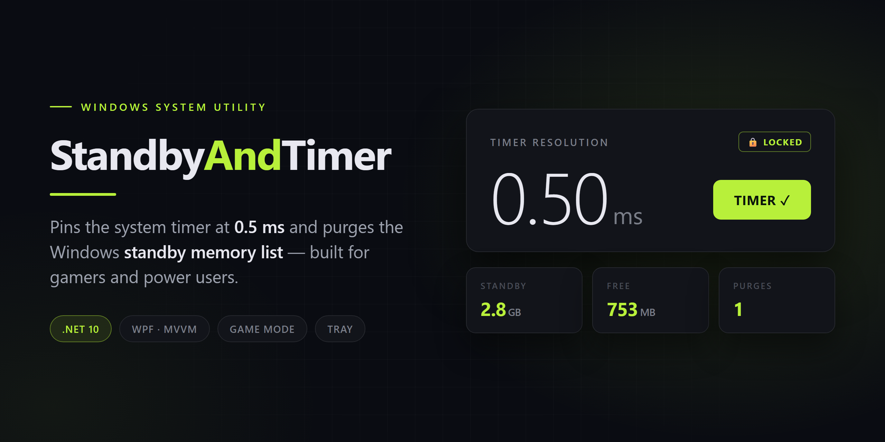
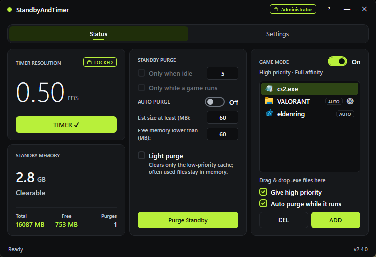
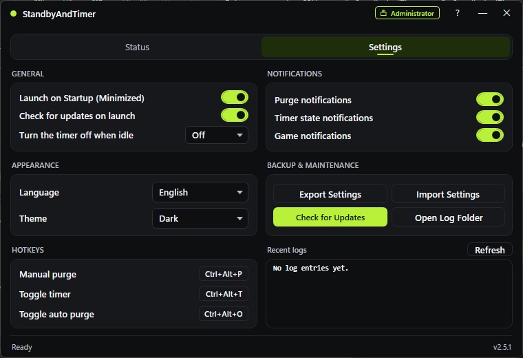
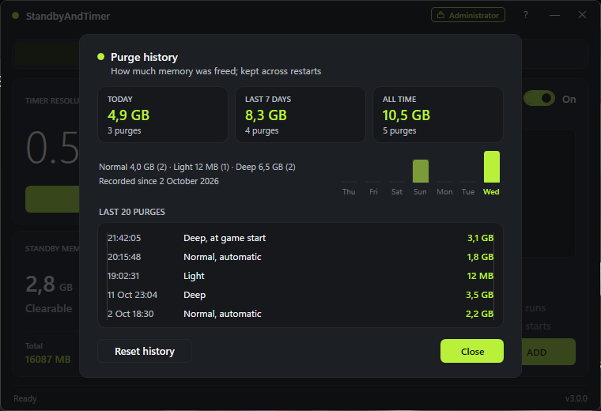
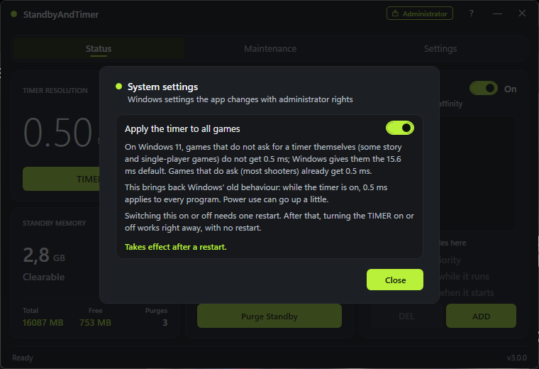
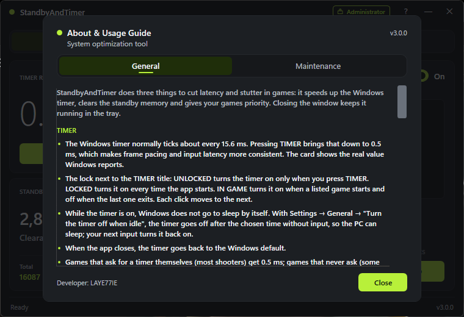
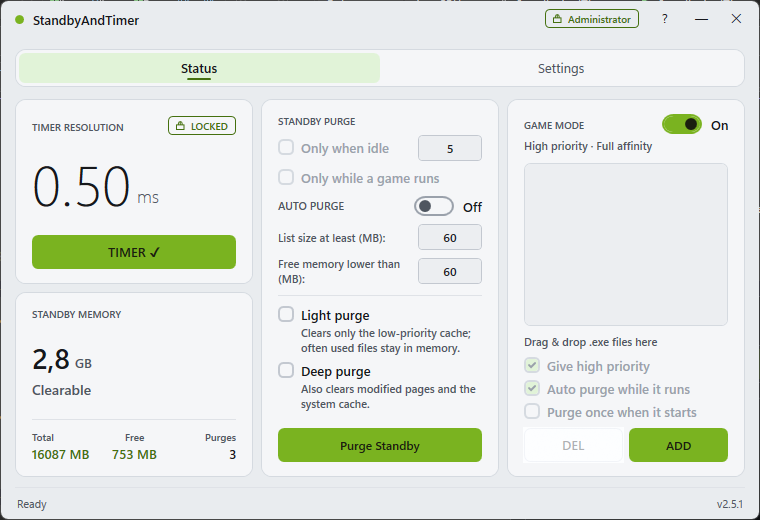
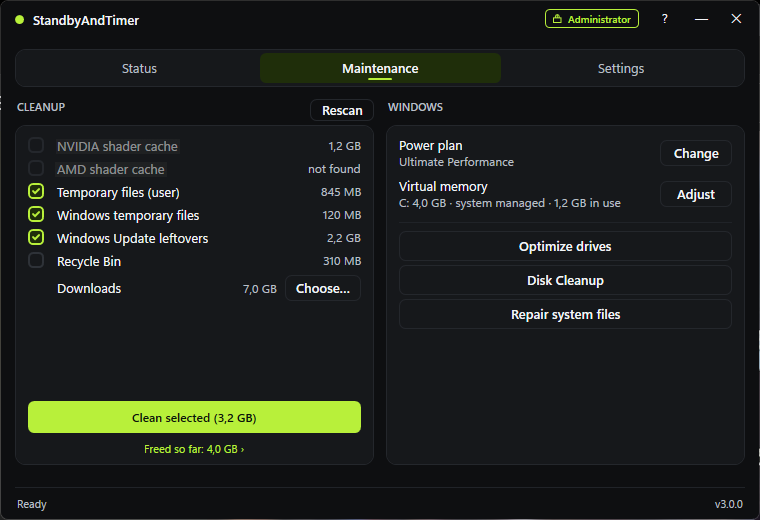
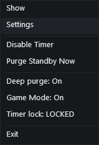

# StandbyAndTimer

A small Windows app for gamers: it makes the system timer finer, frees memory Windows is holding on to, and gives your games priority.

**[English](#english) · [Türkçe](#türkçe)**

<p align="center">
  
  
</p>

<details>
<summary><b>More screenshots · Daha fazla ekran görüntüsü</b></summary>

| | |
|:---:|:---:|
|  |  |
| Purge history · Temizlik geçmişi | System settings · Sistem ayarları |
|  |  |
| Usage guide (**?**) · Kullanım kılavuzu | Light theme · Açık tema |
|  |  |
| Maintenance tab · Bakım sekmesi | Tray menu · Tepsi menüsü |

</details>

[](https://github.com/Layellie/StandbyAndTimer/releases/latest)

---

<a id="english"></a>

# English

## What it does

StandbyAndTimer runs in the system tray and does four separate jobs. You can use any of them on its own.

- Windows normally ticks its system timer about every 15.6 ms. The app asks for 0.5 ms instead, which can make mouse input and frame timing in games more even. The timer card shows the value Windows really runs at, and your display's refresh rate.
- Windows keeps recently used files cached in RAM as "standby" memory. When free RAM runs low, this cache can cause stutters. The app clears it when you press the button, or by itself when free memory drops below a limit you set.
- In Game Mode, the games in your list get High CPU priority and all CPU cores while they run. Drag a game's `.exe` into the list, or let the app add games it sees running fullscreen.
- The Maintenance tab cleans what you tick: shader caches (NVIDIA, AMD, DirectX, Steam), driver installer leftovers, temp files, Windows Update leftovers, the Delivery Optimization cache, crash dumps, Windows logs, the previous Windows installation (Windows.old) and the Recycle Bin. It sends chosen Downloads to the Recycle Bin, keeps a history with a chart, shows Windows' gaming settings (power plan and mode, virtual memory, GPU scheduling, background recording, memory integrity, Game Mode) with a button to Windows' own page for each, and opens Windows' tools (Optimize drives, Disk Cleanup, system file repair). It never leaves the listed folders, skips files in use, and nothing there runs by itself.

## How to use it

1. Download the installer from the [latest release](https://github.com/Layellie/StandbyAndTimer/releases/latest) and run it. It asks for administrator rights, because changing the timer and memory settings needs them.
2. Press **TIMER**. If you want the timer on every time the app starts, click **UNLOCKED** on the Timer card to lock it. While the timer is on, Windows does not go to sleep by itself; to change that, pick a time under Settings → General → **Turn the timer off when idle**.
3. Leave **AUTO PURGE** off unless your games stutter when RAM fills up. If they do, turn it on and set the two limits. The **?** button opens a guide to every feature, with suggested limits for each RAM size.
4. Close the window when you are done. The app keeps working from the tray; right click the tray icon for quick actions.

Hotkeys work from anywhere: `Ctrl+Alt+P` clears standby memory, `Ctrl+Alt+T` turns the timer on or off, `Ctrl+Alt+O` turns auto purge on or off. You can change them under Settings.

## Requirements

Windows 10 (21H1 or later) or Windows 11, 64 bit, administrator rights. You do not need to install .NET; the installer includes everything.

Once the package is approved on winget you can also install it with:

```powershell
winget install Layellie.StandbyAndTimer
```

## Versions

Release notes for every version are on the [Releases page](https://github.com/Layellie/StandbyAndTimer/releases). The app checks for updates on launch and can install them for you. The original WinForms version is kept as [`v1.0.0`](https://github.com/Layellie/StandbyAndTimer/releases/tag/v1.0.0) on the [`winforms-archive`](https://github.com/Layellie/StandbyAndTimer/tree/winforms-archive) branch.

## Building from source

WPF on .NET 10, MVVM. Every Windows API call lives in `Services/Native/NativeMethods.cs`; [`ARCHITECTURE.md`](ARCHITECTURE.md) has the full design.

```powershell
dotnet build StandbyAndTimer/StandbyAndTimer.csproj -c Release
dotnet run --project StandbyAndTimer/StandbyAndTimer.csproj   # run as administrator
.\build-installer.ps1 -Version 3.0.1                          # needs Inno Setup 6
```

## License

[MIT](LICENSE). Copyright © 2026 LAYE77IE.

---

<a id="türkçe"></a>

# Türkçe

## Ne işe yarar?

StandbyAndTimer sistem tepsisinde çalışır ve birbirinden bağımsız dört iş yapar. İstediğinizi tek başına kullanabilirsiniz.

- Windows normalde sistem zamanlayıcısını yaklaşık 15,6 ms'de bir çalıştırır. Uygulama bunun yerine 0,5 ms ister; bu da oyunlarda fare tepkisini ve kare zamanlamasını daha düzenli hale getirebilir. Timer kartı, Windows'un gerçekte çalıştığı değeri ve ekranınızın yenileme hızını gösterir.
- Windows yakın zamanda kullanılan dosyaları RAM'de "standby" bellek olarak tutar. Boş RAM azaldığında bu önbellek takılmalara yol açabilir. Uygulama bu belleği siz butona bastığınızda ya da boş bellek belirlediğiniz sınırın altına düştüğünde kendiliğinden temizler.
- Game Mode açıksa listedeki oyunlar, çalıştıkları sürece Yüksek CPU önceliği ve tüm işlemci çekirdeklerini alır. Oyunun `.exe` dosyasını listeye sürükleyebilir ya da uygulamanın tam ekranda çalışan oyunları kendisinin eklemesini bekleyebilirsiniz.
- Bakım sekmesi, tiklediklerinizi temizler: shader önbellekleri (NVIDIA, AMD, DirectX, Steam), sürücü kurulum artıkları, geçici dosyalar, Windows Update artıkları, Teslimat İyileştirme önbelleği, çökme dökümleri, Windows günlükleri, eski Windows kurulumu (Windows.old) ve Geri Dönüşüm Kutusu. İndirilenler'den seçtiklerinizi Geri Dönüşüm Kutusu'na taşır, grafikli bir geçmiş tutar, Windows'un oyunla ilgili ayarlarını (güç planı ve modu, sanal bellek, GPU zamanlaması, arka planda kayıt, bellek bütünlüğü, Oyun Modu) her biri için Windows'un kendi sayfasını açan bir butonla gösterir ve Windows'un araçlarını (Sürücüleri iyileştir, Disk Temizleme, sistem dosyası onarımı) açar. Listedeki klasörlerin dışına çıkmaz, kullanımdaki dosyaları atlar; oradaki hiçbir şey kendiliğinden çalışmaz.

## Nasıl kullanılır?

1. Kurulum dosyasını [son sürümden](https://github.com/Layellie/StandbyAndTimer/releases/latest) indirip çalıştırın. Timer ve bellek ayarlarını değiştirmek yönetici yetkisi gerektirdiği için kurulum bu yetkiyi ister.
2. **TIMER** butonuna basın. Timer'ın uygulama her açıldığında açık gelmesini istiyorsanız Timer kartındaki **KİLİTSİZ** yazısına tıklayıp kilitleyin. Timer açıkken Windows kendiliğinden uykuya geçmez; bunu değiştirmek için Ayarlar → Genel → **Boştayken timer'ı kapat** altından bir süre seçin.
3. Oyunlarınız RAM dolduğunda takılmıyorsa **OTO TEMİZLE**'yi kapalı bırakın. Takılıyorsa açın ve iki sınırı ayarlayın. **?** butonu her özelliği anlatan bir kılavuz açar; her RAM boyutu için önerilen sınırlar da orada.
4. İşiniz bitince pencereyi kapatın. Uygulama tepside çalışmaya devam eder; hızlı işlemler için tepsi simgesine sağ tıklayın.

Kısayollar her yerden çalışır: `Ctrl+Alt+P` standby belleği temizler, `Ctrl+Alt+T` timer'ı açıp kapatır, `Ctrl+Alt+O` oto temizlemeyi açıp kapatır. Ayarlar sekmesinden değiştirebilirsiniz.

## Gereksinimler

Windows 10 (21H1 ve sonrası) ya da Windows 11, 64 bit, yönetici yetkisi. .NET kurmanıza gerek yoktur; kurulum dosyası gereken her şeyi içerir.

Paket winget'te onaylandığında şu komutla da kurabilirsiniz:

```powershell
winget install Layellie.StandbyAndTimer
```

## Sürümler

Her sürümün notları [Releases sayfasında](https://github.com/Layellie/StandbyAndTimer/releases). Uygulama açılışta güncellemeleri kontrol eder ve yeni sürümü sizin yerinize kurabilir. İlk WinForms sürümü, [`winforms-archive`](https://github.com/Layellie/StandbyAndTimer/tree/winforms-archive) dalında [`v1.0.0`](https://github.com/Layellie/StandbyAndTimer/releases/tag/v1.0.0) olarak saklanıyor.

## Kaynaktan derleme

.NET 10 üzerinde WPF, MVVM. Windows API çağrılarının hepsi `Services/Native/NativeMethods.cs` içinde; tasarımın tamamı [`ARCHITECTURE.md`](ARCHITECTURE.md) dosyasında.

```powershell
dotnet build StandbyAndTimer/StandbyAndTimer.csproj -c Release
dotnet run --project StandbyAndTimer/StandbyAndTimer.csproj   # yönetici olarak çalıştırın
.\build-installer.ps1 -Version 3.0.1                          # Inno Setup 6 gerekir
```

## Lisans

[MIT](LICENSE). Telif hakkı © 2026 LAYE77IE.
